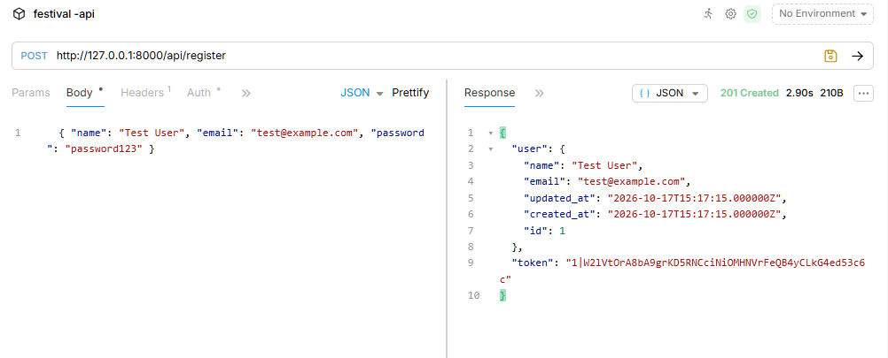
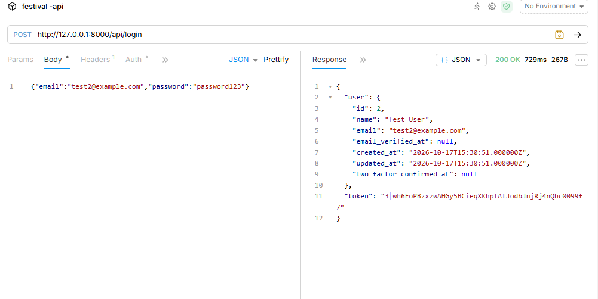
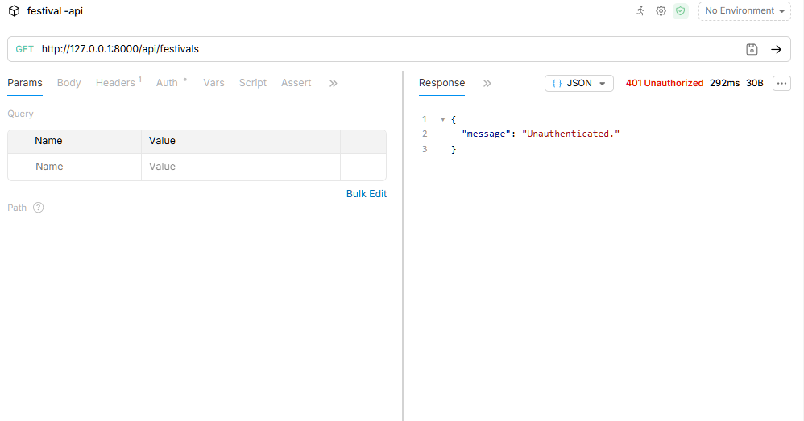
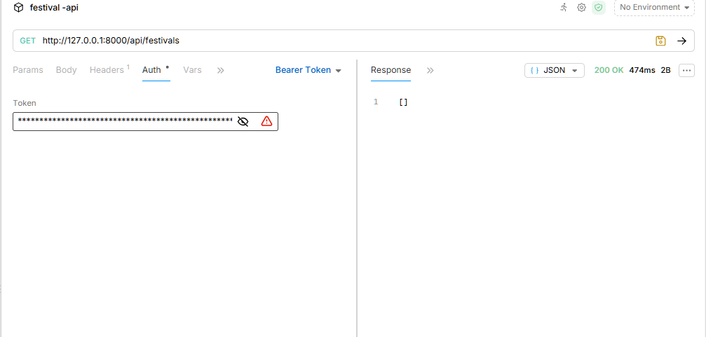
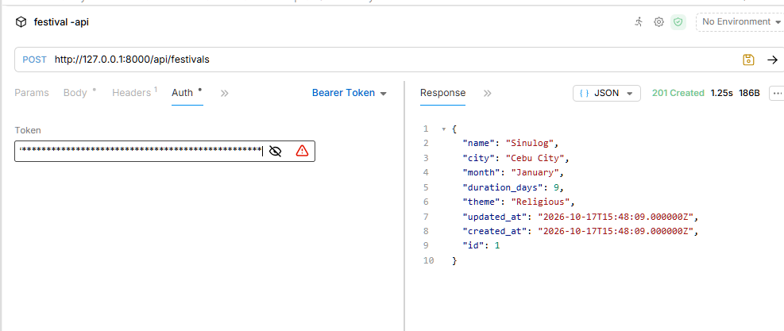
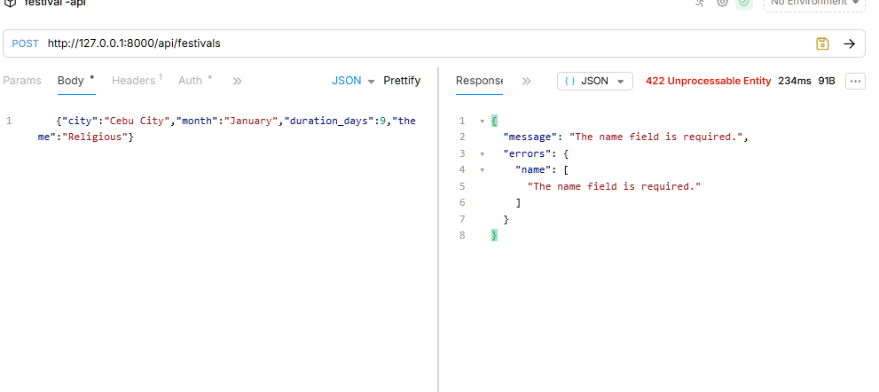
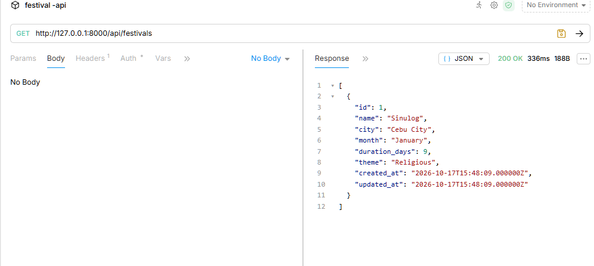
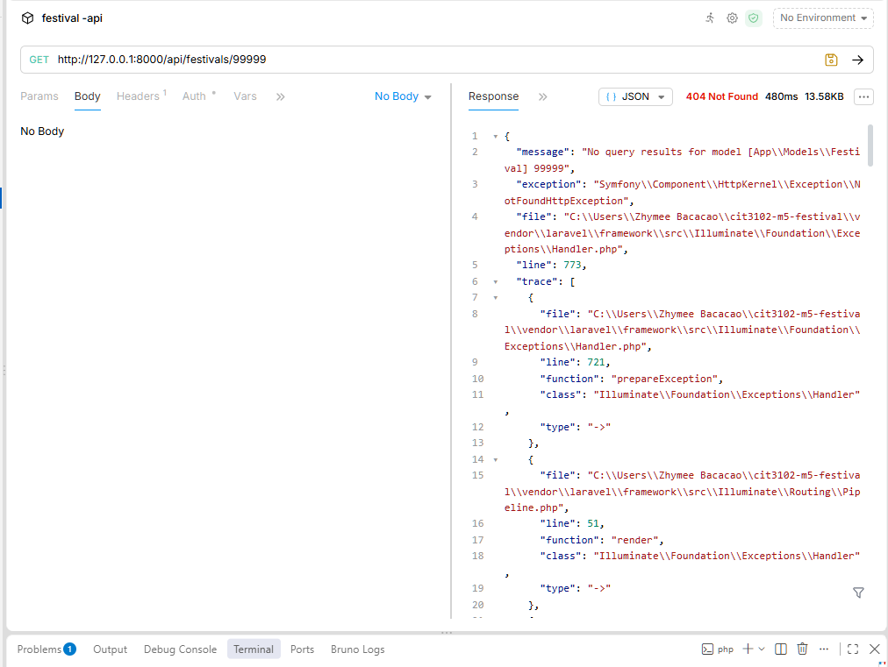
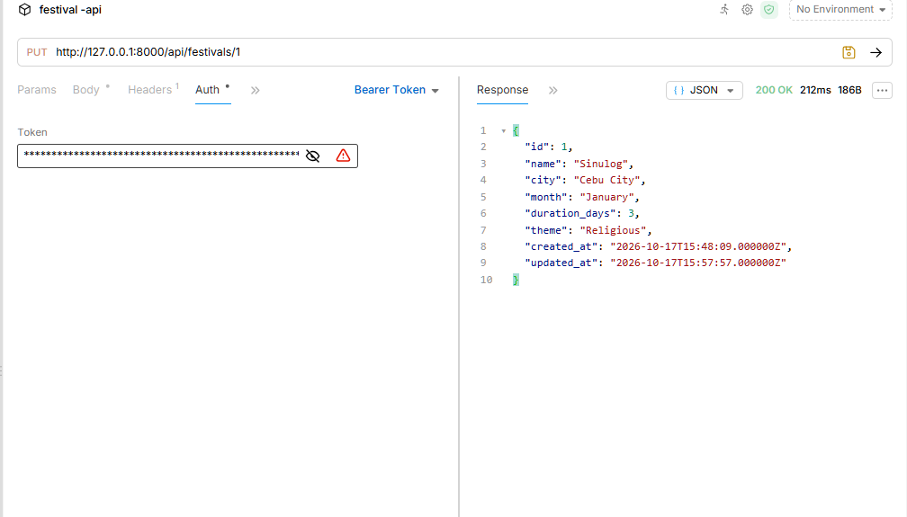
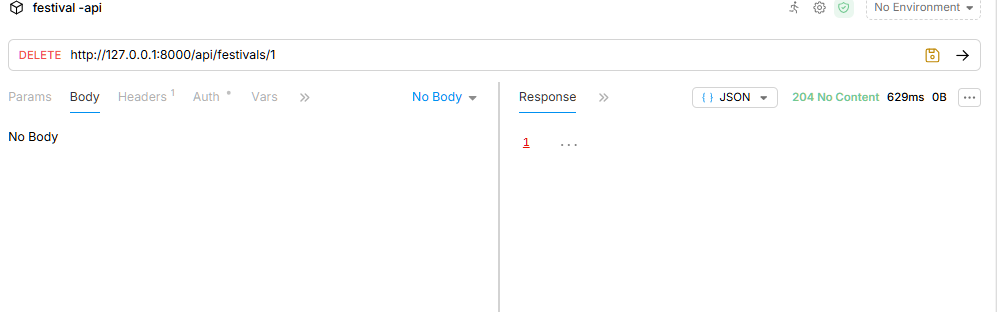

# Festival API
Partners: bacacao, Zhymee
Section: IT2E
Resource claimed: Festival

A Laravel REST API with Sanctum token authentication for Philippine festivals.

| Field | Type |
|---|---|
| name | string |
| city | string |
| month | string |
| duration_days | integer |
| theme | string |

## Setup (from a fresh clone)

```bash
git clone https://github.com/<your-username>/cit3102-m5-festival.git
cd cit3102-m5-festival
composer install
cp .env.example .env
php artisan key:generate
touch database/database.sqlite      # on Windows: type nul > database\database.sqlite
php artisan migrate
php artisan serve
```

The API is then at `http://127.0.0.1:8000/api`. Send `Accept: application/json` and, for protected routes, `Authorization: Bearer <token>`.

## Routes

| Verb | Path | What it does | Needs token? |
|---|---|---|---|
| POST | /api/register | Create a user and return a token | No |
| POST | /api/login | Log in and return a token | No |
| POST | /api/logout | Delete the current token | Yes |
| GET | /api/me | Show the logged-in user | Yes |
| GET | /api/festivals | List festivals (filter with `?city=`, `?month=`, `?theme=`) | Yes |
| POST | /api/festivals | Create a festival | Yes |
| GET | /api/festivals/{festival} | Show one festival | Yes |
| PUT | /api/festivals/{festival} | Update a festival | Yes |
| DELETE | /api/festivals/{festival} | Delete a festival | Yes |

## Proof: the ten requests

1. POST /api/register → 201
   
2. POST /api/login → 200
   
3. GET /api/festivals, no token → 401
   
4. GET /api/festivals, with token → 200
   
5. POST /api/festivals, valid data → 201
   
6. POST /api/festivals, required field missing → 422
   
7. GET /api/festivals/1 → 200
   
8. GET /api/festivals/99999 → 404
   
9. PUT /api/festivals/1 → 200
   
10. DELETE /api/festivals/1 → 204
    

## Why does DELETE return 204 and not 200?

DELETE returns 204 No Content because the festival no longer exists after it is deleted, so there is nothing left to send back. A 200 response usually comes with a body that shows data, but a deleted record has no data to show. The 204 status by itself tells the client that the request worked and that the response is empty on purpose. This also saves a little bandwidth, because the server does not need to send a message when the status code already says it succeeded.
